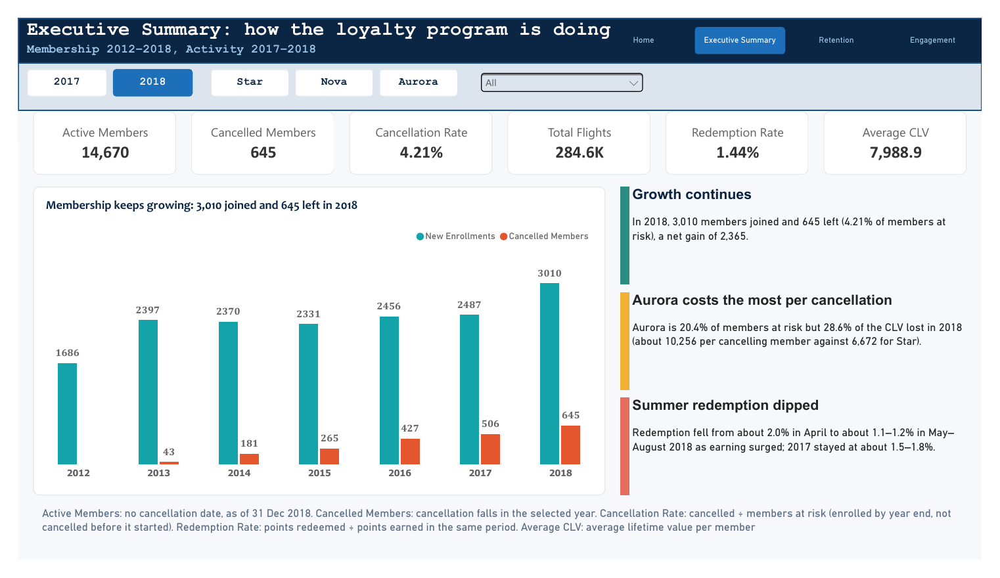
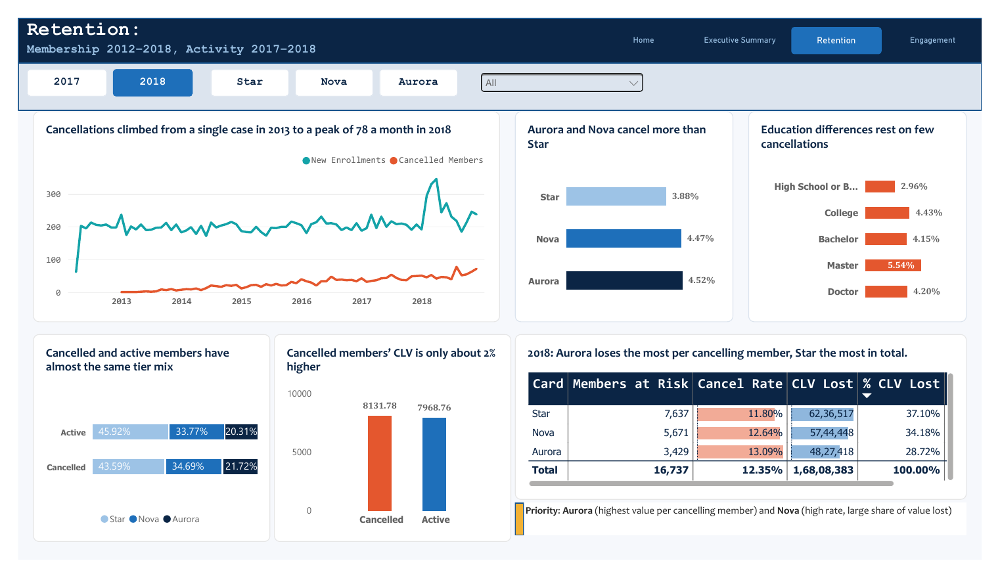
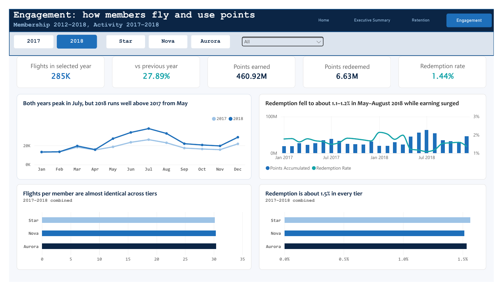

# Airline Loyalty Program Retention and Engagement Analytics

---

## Executive Summary

An airline loyalty program was adding members quickly, but leadership lacked a clear view of who was leaving, how much value left with them, and whether members were using their points. This project models 16,737 members and 389K monthly activity records into a star-schema Power BI report that answers those questions across retention and engagement.

**Core Impact:** Pinpointed **Aurora** as only 20.4% of members at risk but **28.6% of the 5.06M customer lifetime value (CLV) lost** in 2018, and exposed a **1.54% points redemption rate** despite **38% growth in points earned**, giving the program two clear priorities: targeted retention and a redemption campaign.

---

## Dashboard Preview

| Retention | Engagement |
|:---:|:---:|
|  |  |

Full report: `project-file/Airline_Loyalty_Analytics.pbix` (also exported as a PDF in the same folder).

---

## Business Question

Which loyalty members are most likely to leave, which tiers carry the most value at risk, and how can the program increase engagement and points redemption?

---

## Tech Stack

| Layer | Tools |
|:---|:---|
| Business Intelligence | Power BI Desktop (3-page interactive report, slicers, page navigation) |
| Data Preparation | Power Query (M), including `Table.Buffer` for deterministic deduplication |
| Data Modeling | Star schema: 1 fact table (`Activity`) and 2 dimensions (`Members`, `Calendar`), with inactive relationships activated through `USERELATIONSHIP` |
| Calculations | DAX: 23 measures covering enrollments, cancellations, cancellation rate, CLV lost, flights, points and redemption |

---

## Data Pipeline and Methodology

| Step | Stage | Focus |
|:---:|:---|:---|
| 1 | Cleaning (Power Query) | Deduplicated 392,936 raw activity rows to **389,065** (one row per member per month); standardized dates to month grain; derived `Status` and `Cancellation Date`; removed unused columns |
| 2 | Modeling | Built the star schema with a daily `Calendar`; kept CLV at member level so it is never summed across monthly rows |
| 3 | Measures (DAX) | Defined 23 measures with documented rules, such as Cancellation Rate = cancelled members divided by members at risk |
| 4 | Dashboard | Designed Executive Summary, Retention and Engagement pages with tier and year slicers and plain-language insight callouts |
| 5 | Validation | Reconciled headline figures (members, cancellations, flights, points, CLV lost) against the source tables |

**Key data decisions** (full detail in `project-file/Data_Decisions_and_Analytical_Findings.md`):

| Issue | Decision |
|:---|:---|
| Duplicate member-month activity rows | Removed identical copies; for conflicting rows kept the highest flights to avoid double counting |
| 25.3% of members missing salary (all in the College group) | Kept all members, excluded income from the analysis, dropped the column rather than inventing values |
| Cancellation recorded as separate year and month fields | Derived one consistent Active or Cancelled rule and a single `Cancellation Date` |
| Activity dated before enrollment (8,207 real flights) | Retained, so genuine flights are not lost to enrollment-date lags |

**Dataset Note:** Membership data covers 2012 to 2018 (16,737 members); flight activity covers 2017 to 2018, with a cut-off of 31 December 2018.

---

## Key Findings

| # | Finding | Evidence |
|:---:|:---|:---|
| 1 | **Aurora carries the most value at risk per cancellation** | Aurora is **20.4%** of members at risk but **28.6%** of CLV lost; each departing Aurora member averages **10,256** CLV, **54% higher** than Star (6,672). |
| 2 | **Premium tiers cancel slightly more** | 2018 cancellation rate: Aurora **4.52%**, Nova **4.47%**, Star **3.88%**, against **4.21%** overall. The spread is modest and directional. |
| 3 | **Growth is strong, but cancellations are rising** | **3,010** joined and **645** left in 2018 (net **+2,365**). Cancellations grew from 506 in 2017, and reached about 30% of monthly enrollments by December 2018. |
| 4 | **Almost nobody redeems points** | Only **1.54%** of points earned were redeemed (12.23M of 794.18M), and the rate is about 1.5% in every tier. |
| 5 | **Redemption dipped as earning surged** | Points earned grew **38.3%** in 2018, while monthly redemption fell from about 2.0% in April to **1.1% to 1.2%** in May to August. |
| 6 | **2018 flights jumped, especially in summer** | Flights rose **27.9%** (222,547 to 284,613); July 2018 was **44%** above July 2017. |
| 7 | **Tier does not change how often members fly** | Flights per member are nearly identical: Aurora 30.41, Nova 30.36, Star 30.21. Cancelled and active members also look alike (average CLV 8,132 vs 7,969). |

---

## Strategic Recommendations

| Priority | Recommendation | Rationale |
|:---:|:---|:---|
| 1 | **Prioritize Aurora for retention, then Nova** | Aurora has the highest rate and highest CLV per cancelling member; Nova has a high rate and 35.6% of CLV lost. |
| 2 | **Launch a points redemption campaign** | At 1.54%, points are barely used. Time offers ahead of summer, when redemption fell as earning peaked. |
| 3 | **Monitor the rising cancellation trend** | Cancellations are climbing toward a third of monthly enrollments, which could erode net growth. |
| 4 | **Use behavior, not tier or demographics, to target outreach** | Tier, education and profile show little difference in engagement or churn, so activity-based signals are needed. |
| 5 | **Capture cancellation reasons and retention costs** | Neither is in the data today, which limits root-cause analysis and campaign ROI modeling. |

---

## Notes and Limitations

- **CLV is a proxy** for value at risk, based on historical lifetime value rather than future behavior.
- **Tier gaps are directional.** The roughly 0.6 point spread between tiers is modest, and education and province outliers rest on small counts (26 or fewer cancellations).
- **Redemption rate** divides points redeemed by points earned in the same period, so heavy earning periods lower the ratio mechanically.
- **2018 enrollment spike** coincides with the "2018 Promotion" enrollment type, but the data has no campaign dates or spend to confirm causality.
- **Dates** are stored at month level (first day of each month) because the source has no day values.

---

## Repository Structure

| Path | Description |
|:---|:---|
| `project-file/Airline_Loyalty_Analytics.pbix` | Power BI report with the data model, DAX measures and three dashboard pages. |
| `project-file/Airline_Loyalty_Analytics_Dashboard.pdf` | PDF export of the report. |
| `project-file/Data_Decisions_and_Analytical_Findings.md` | Cleaning decisions, KPI definitions and detailed findings. |
| `assets/` | Dashboard screenshots used in this README. |
| `README.md` | Project documentation and executive summary. |
